# Discover Egypt — recorded demo

Recorded automatically by CI from commit `0f47706` on 24 November 2026, with the site running on a real (local) Supabase database: sign-up with email confirmation, the Memory Hunt and Memory Passport, cloud backup, and the admin dashboard.

**Video:** [discover-egypt-demo.mp4](discover-egypt-demo.mp4)

### 01-home

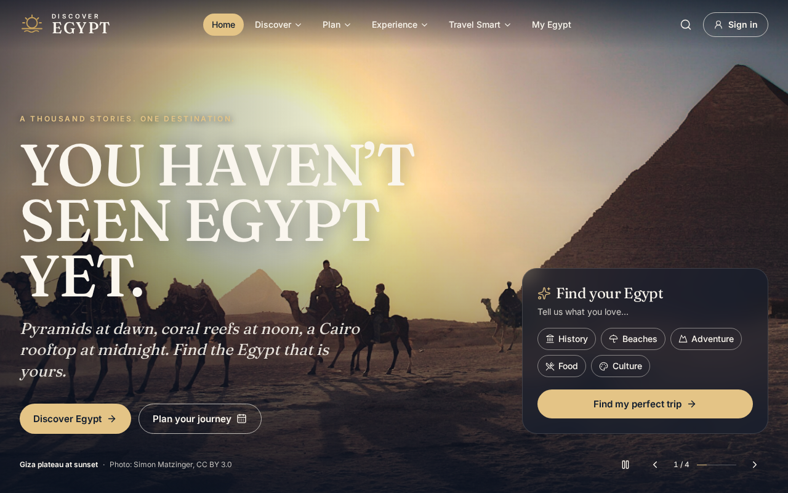

### 02-home-features

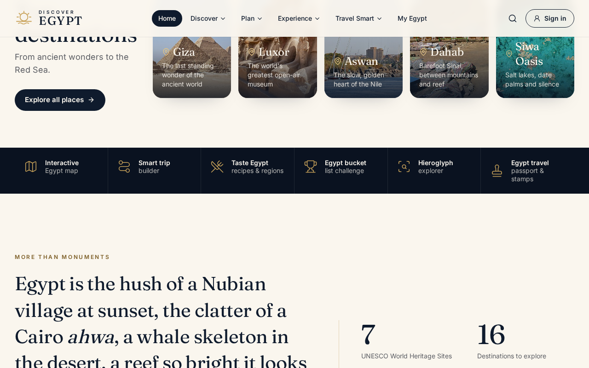

### 03-discover

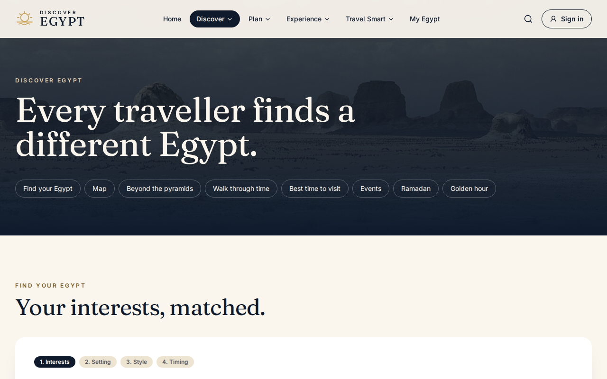

### 04-create-account

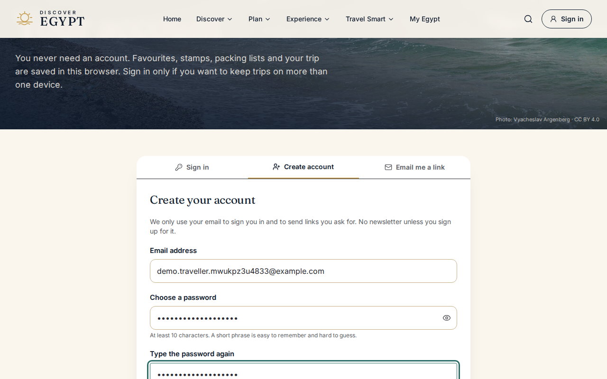

### 05-check-inbox

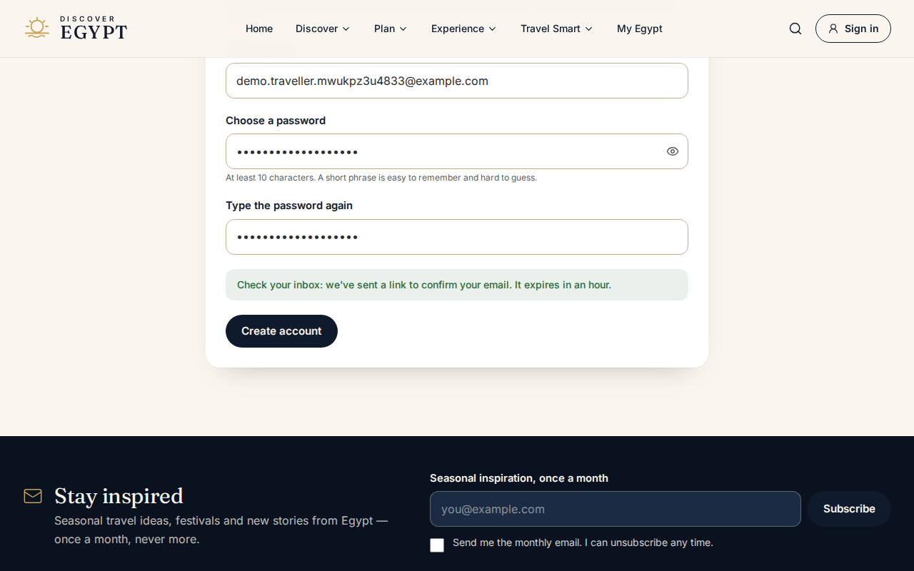

### 06-signed-in

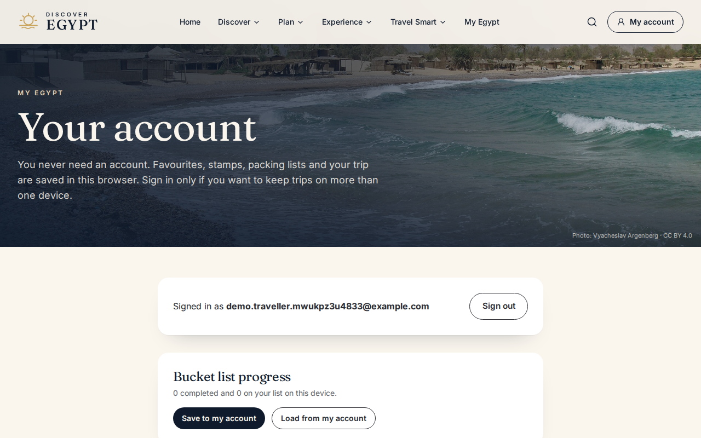

### 07-memory-hunt

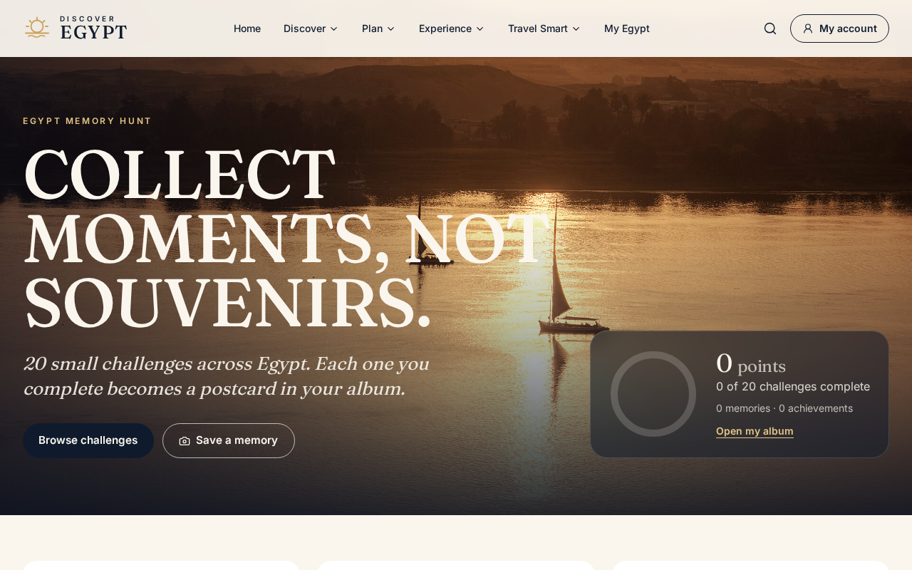

### 08-postcard-editor

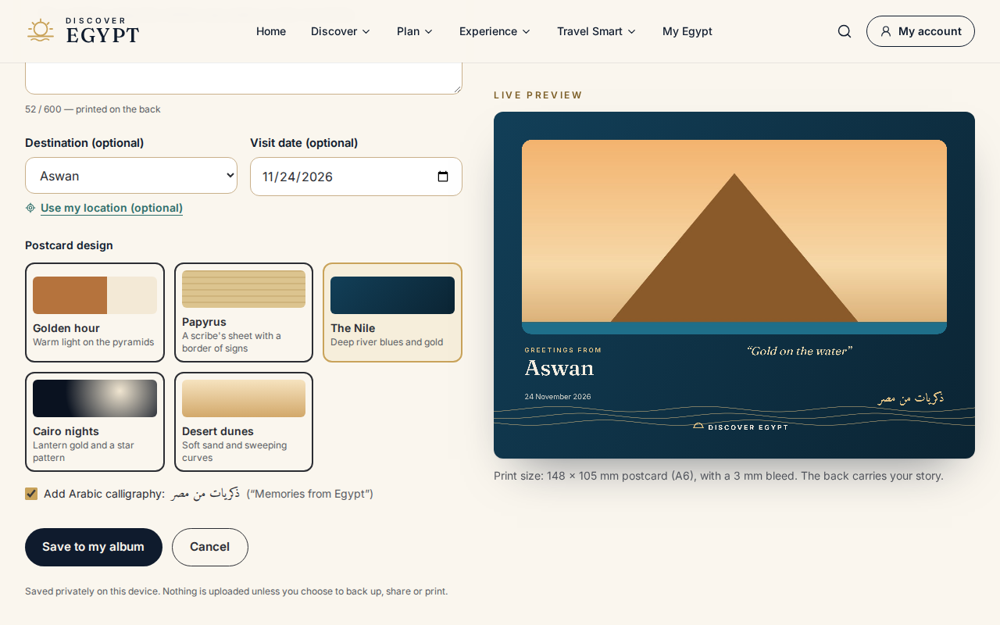

### 09-passport-cover

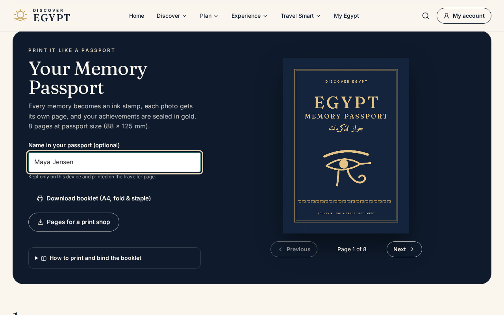

### 10-passport-traveller-and-stamps

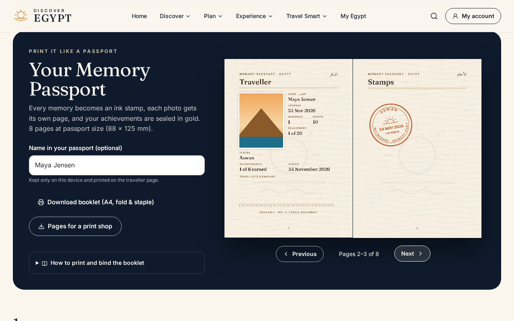

### 11-passport-memory

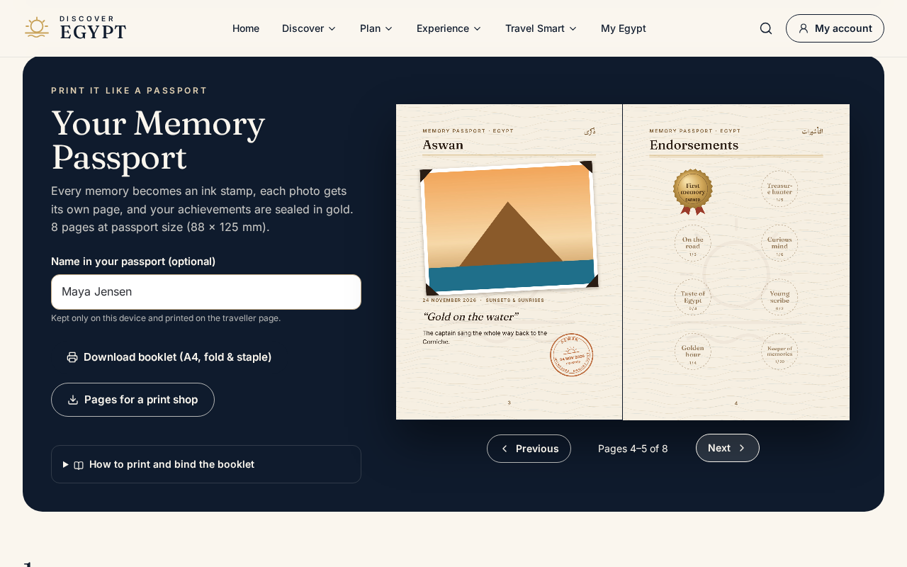

### 12-backed-up

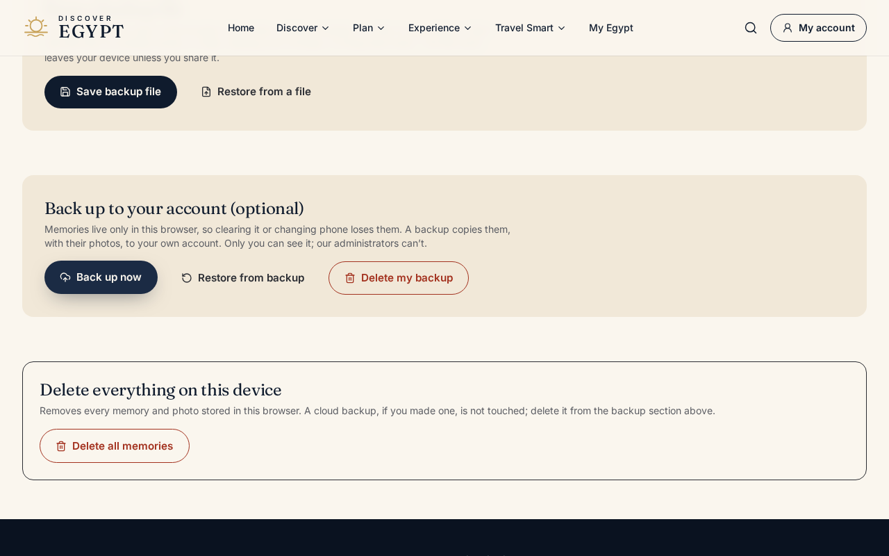

### 13-hieroglyphs

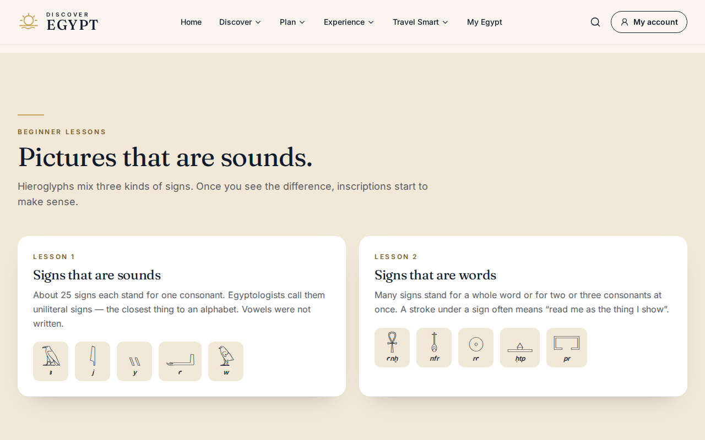

### 14-admin-dashboard

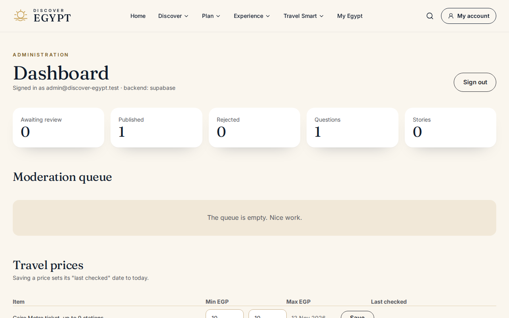

### 15-admin-printing

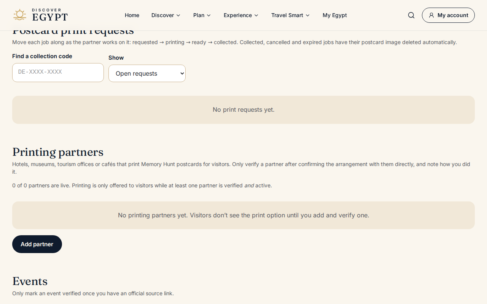

